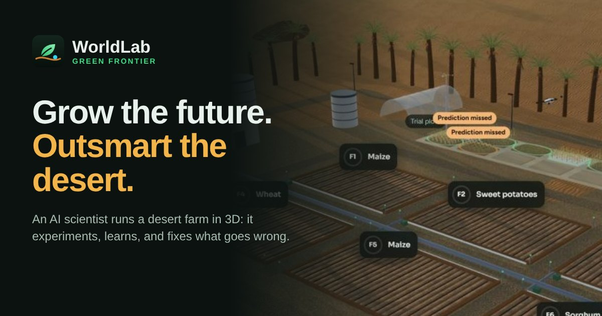
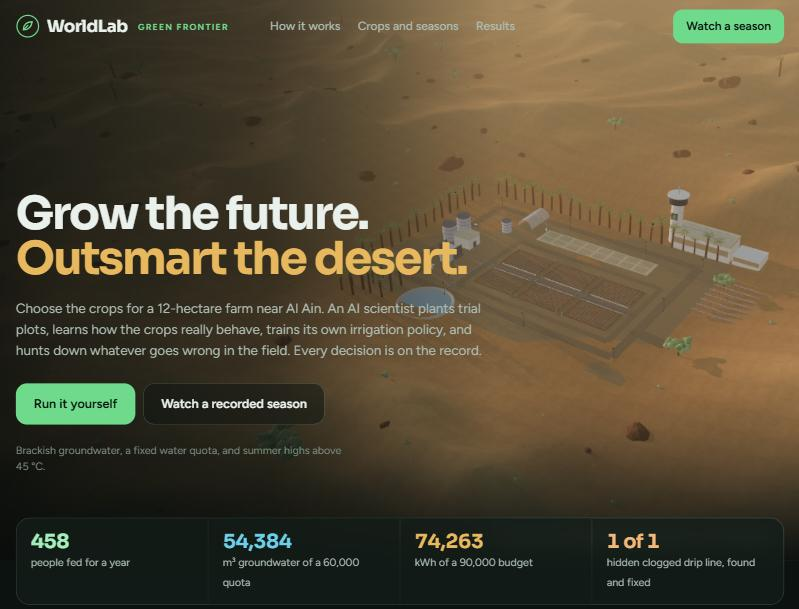
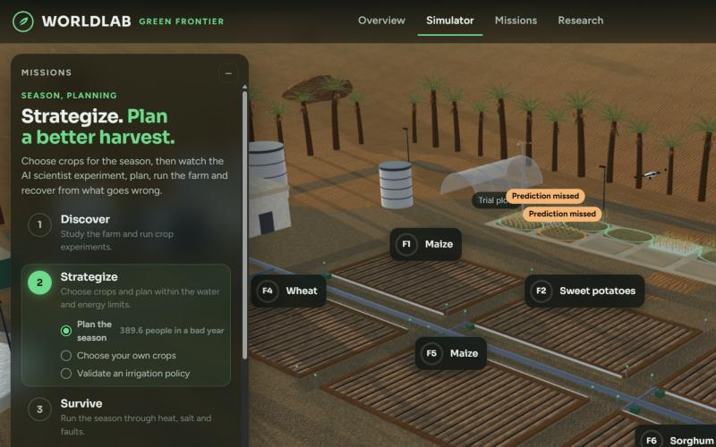
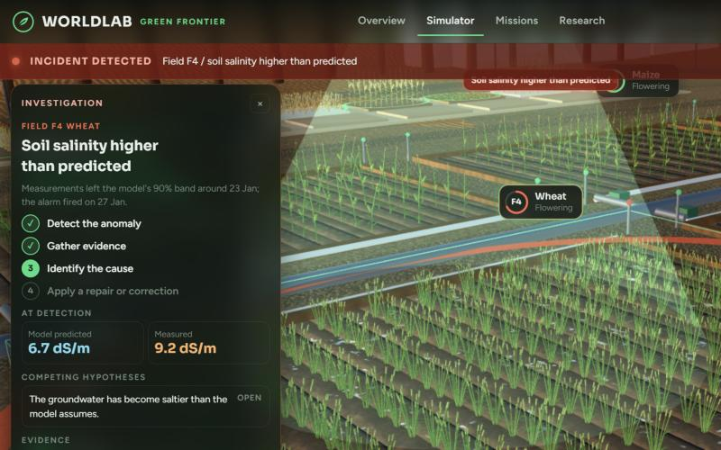
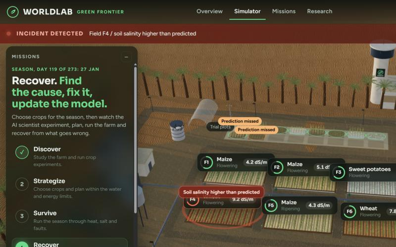
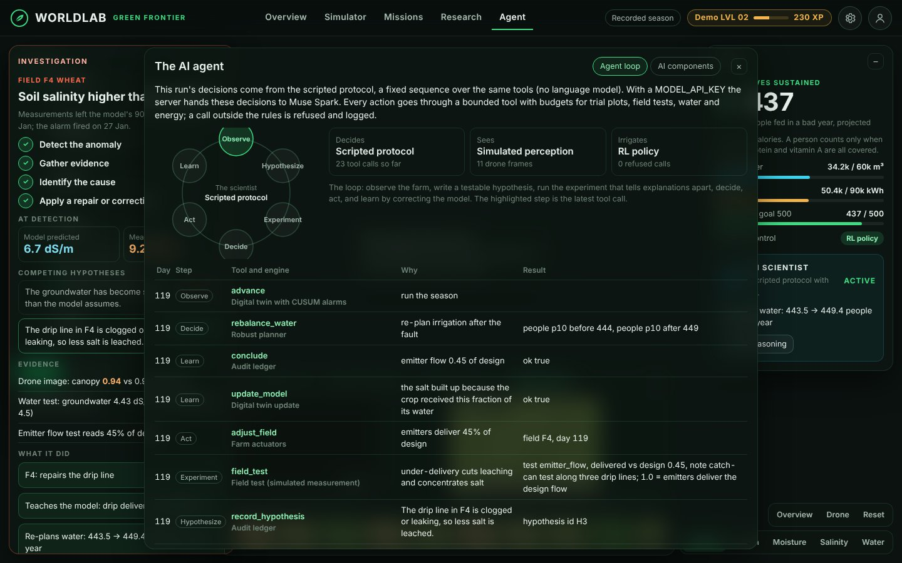
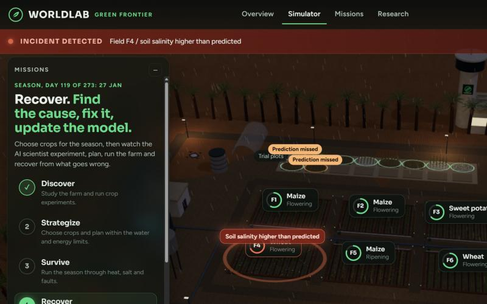

<p align="center"></p>

# WorldLab: Green Frontier

*Grow the future. Outsmart the desert.*

**An AI scientist that runs a desert farm in 3D. You choose the crops; it plants trial plots, learns how the crops really behave, trains its own irrigation policy, and finds and fixes what goes wrong in the field. Every decision is on the record.**

**[Open the website](https://moamryehia.github.io/WorldLab/)** · **[Watch a recorded season](https://moamryehia.github.io/WorldLab/app/?demo)** (no account needed) · Built for the Meta Global AI Developer Hackathon, theme *Push the Frontier*

| | |
|---|---|
|  |  |
| **Landing page.** A live 3D flyover of the farm, replaying a recorded season. | **The farm.** Six fields, ten crops that grow with the simulation, trial plots, and the infrastructure that waters them. |
|  |  |
| **An incident.** Salinity in F4 leaves the model's band; the camera flies in, the drone scans, the investigation panel lists hypotheses, tests and the repair. | **Scientific overlays.** Crop health, soil moisture, salinity and irrigation, with units, from the latest sensor readings. |
|  |  |
| **The agent.** Its observe, hypothesize, experiment, decide, act, learn loop and every tool call with its reason, result and engine. | **Time of day.** Morning, noon, golden hour and night, with lights that switch on after dark. |

## What you can do

- **Plan a season.** Pick crops for six fields across three sowing seasons. Each crop card shows a picture rendered from its 3D model, the sowing window, days to harvest, the needs it covers, its salt limit and the expected yield on every field; your picks appear as 3D previews in the fields.
- **Watch the AI scientist work.** Five chapters (Discover, Strategize, Survive, Recover, Harvest) with objectives that tick off only when the audit ledger shows they happened.
- **Follow the agent.** The Agent tab shows each tool call it makes and why, and a table of every AI component and whether it is active.
- **See through the drone.** The Drone feed shows the drone's live camera in the 3D farm beside the frames it captures on survey and inspection flights.
- **Investigate incidents.** When measurements leave the model's predicted band, the season pauses and the investigation panel shows the competing hypotheses, the evidence and the fix.
- **Earn achievements.** First Sprout, Water Steward, Scientific Detective, Resilience Architect, Harvest Guardian, Adaptive Intelligence and Diverse Farm, each backed by ledger evidence. With an account, progress is saved and rewards can't be farmed by replaying.

## The challenge

The farm is 12 hectares near Al Ain in the UAE: six fields with different soils, some already saline, irrigated by drip from brackish groundwater that can be blended with desalinated water. Water and energy are capped. The agent chooses among ten food-security crops: wheat, rice, maize, potatoes, cassava, soybeans, sorghum, millet, common beans and sweet potatoes.

The local varieties don't behave quite like the published values, and the agent isn't told how. To do well it has to:

1. **Run trials.** Design trial plots that expose the traits that matter: a saline plot reveals salt tolerance, a late sowing reveals heat tolerance at flowering.
2. **Calibrate.** Infer each crop's hidden traits from drone imagery and harvests.
3. **Plan for a bad year.** Choose which crop goes on which field, with sowing date, irrigation, water blend and nitrogen, to maximise the people fed in a bad year. Someone counts as fed only when calories, protein *and* vitamin A are all covered.
4. **Learn a policy.** Train a daily irrigation and water-blend policy by reinforcement learning inside its own calibrated model of the farm, and use it only if it beats the fixed rule on held-out imagined seasons.
5. **Run the season and stay honest.** Run the season day by day against its own predictions. When a field drifts out of the predicted band, it forms hypotheses, runs the field test that tells them apart, fixes the cause, corrects its model and re-plans its water.

Every hypothesis, prediction, trial, test, decision and result is written to a hash-chained ledger and shown live in the web app: a dark command-centre interface over an interactive 3D farm at golden hour. Everything in the 3D world is real geometry driven by the simulation, not a picture: ten botanically distinct crops that grow through their stages, wilt under water stress, pale under salt and heat, show pest damage and sway with the measured wind; soil that darkens around wet emitters and crusts with salt; drip lines that turn red when clogged; dust, clouds and rain driven by the weather record; a drone that flies out to scan a field; a service truck that drives out to repair a line; an alarm ring on the field whose measurements left the model's predicted band. Orbit, zoom and pan, click a field to inspect it, or switch to scientific overlays of crop health, soil moisture, salinity and irrigation (with units).


**The recorded season** (the demo on the website): on 4 January a drip line in field F4 is silently clogged. The water meter can't see it, and the scientist isn't told. Less water reaches the roots, so less salt is leached, and on 27 January soil salinity leaves the model's predicted band. The scientist pauses, writes two hypotheses, and runs the test that separates them: the groundwater test reads normal (4.43 dS/m against an assumed 4.5) and the emitter flow test reads 45% of design. It concludes the line is clogged, repairs it, teaches its model the delivered fraction and re-plans water. Before sowing it had trained an RL irrigation policy (322 parameters, 39,000 imagined seasons in 51 s) and deployed it. The harvest feeds 458 people, using 54,384 m³ of a 60,000 m³ groundwater quota and 74,263 kWh of a 90,000 kWh energy budget.


### The website

| Page | What it does |
|---|---|
| `/` | Landing page: a cinematic 3D flyover of the farm replaying a season, numbers from that season, how a season runs, the sowing calendar, benchmark results |
| `/signup`, `/login` | Accounts. Each account gets its own farm, its own runs and a history of past seasons |
| `/app` | Your farm. **Plan a new season** opens the season planner with 3D previews of your crops; missions, field gauges, the incident investigation, the research lab and the results screen follow the run live |
| `/demo` | A recorded season, no account needed |

**Choosing crops by season.** The growing year runs from 1 October to 30 June; open fields rest through the summer. The planner has three sowing seasons:

| Season | Sowing dates | Crops that can be sown |
|---|---|---|
| Autumn sowing | 1 Oct to 15 Nov | maize, cassava, sweet potatoes, potatoes, common beans, wheat |
| Winter sowing | 16 Nov to 31 Dec | wheat, potatoes, common beans |
| Late-winter sowing | 25 Jan to 15 Mar | rice, soybeans, sorghum, millet |

For each of the six fields you pick a season and a crop, leave it fallow, or let the scientist decide. Each crop card shows its sowing window, days to harvest, the needs it covers (calories, protein, vitamin A), its salt limit, and the yield the crop model expects on every field. The scientist still runs trial plots, then plans sowing day, irrigation, water blend and nitrogen for your crops and chooses crops for the fields you left open. It also reports how many people its own free choice would feed, so you can see what your picks cost or gain.

**Missions and progression.** A season runs through five chapters: Discover (trial plots), Strategize (plan within the water and energy limits), Survive (run the season), Recover (detect, diagnose and repair hidden faults) and Harvest. Objectives, achievements and experience are computed from the run's audit ledger by `worldlab/progression.py`, the same code for live seasons and recorded replays, so nothing is awarded that the ledger doesn't show. Achievements: First Sprout, Diverse Farm, Adaptive Intelligence, Scientific Detective, Resilience Architect, Water Steward and Harvest Guardian. Progress is saved per account; season experience counts once per farm and crop choice, replays earn nothing, and beating your best on the same scenario earns only the difference.

**Controls and performance.** Drag to orbit, scroll or pinch to zoom, right-drag to pan, arrow keys to move. Keys: `1`–`6` fly to a field, `O` overview, `D` follow the drone, `I` close-up, `R` reset, `V` cycle overlays, space play or pause a replay, `Esc` close a panel. Settings offer Low, Medium, High and Ultra quality or automatic (it steps down when the measured frame rate drops), time of day (morning, noon, golden hour, night) and 3D labels; the measured frame rate is shown there. Crops and palms are instanced, geometry is shared and disposed on quality changes, and reduced-motion settings stop the camera flights. Without WebGL the panels still show the season.

**Accounts** are stored in SQLite (`WORLDLAB_DATA`, default `./data`). Passwords are hashed with scrypt and a per-user salt; sessions are random tokens in an HttpOnly cookie, stored only as SHA-256 digests; cross-site POSTs are refused and repeated failed logins are throttled.

**Hosting: GitHub Pages for the website, Hugging Face for the server.** `docs/` is a static copy of the whole site (landing page, log in, sign up, and the farm app in `docs/app/`). GitHub Pages serves it; accounts, crop planning and live seasons call the Python server, which runs on a Hugging Face Space. The address of that server is set in `docs/config.js`. If the server can't be reached, the Pages site still shows the landing page and a recorded season. See [Deploy](#deploy-github-pages--hugging-face) below.

Built for the Meta Global AI Developer Hackathon, theme **Push the Frontier** (agriculture, food security).

---

## How Meta's models are used

| Model | Role |
|---|---|
| **Muse Spark** (`muse-spark-1.3`, Meta Model API) | The scientist. It drives everything through **tool calling**: it records hypotheses, designs trials, decides when beliefs are good enough to plan, chooses which field test to run, interprets results, acts and concludes. Every call carries a written rationale that lands in the ledger. |
| **SAM 3.1** (`sam-3.1`, Meta Model API) | Reads drone images. It counts plants (stand loss), finds white salt crust and spots brown leaf damage by noun phrase. |
| **Muse Spark** vision + **structured output** | Gives a stress diagnosis for each drone image (healthy, water stress, pest damage, salt damage, sparse stand) with evidence. |
| **Muse Glimmer** (open weights, Apache 2.0) | A drop-in scientist running on your own GPU or any OpenAI-compatible host. It gets the same tools and prompt, so the two can be benchmarked head to head. |

The language model never acts on the farm directly. It decides, numerical code does the agronomy, and budgets bound every action: trial plots, field tests, the groundwater quota and the energy budget.

## All the AI components

WorldLab is an agent. Its loop: **observe** the farm, write a testable **hypothesis**, run the **experiment** that tells explanations apart, **decide**, **act** through bounded tools, and **learn** by correcting its own model. The app's **Agent** tab shows that loop and every tool call with its reason, result and the engine that ran it; the same tab lists the components below with whether each is active in the season on screen.

| Component | Kind | What it does | How it works | In the recorded demo |
|---|---|---|---|---|
| Muse Spark | Meta model | The scientist: chooses every next step | Function calling over 19 tools (`worldlab/agent.py`) | Replaced by the scripted protocol (no API key on a static host) |
| Muse Glimmer | Meta open weights | The same scientist on your own GPU | Any OpenAI-compatible endpoint, same tools and prompt | Not used |
| SAM 3.1 | Meta model | Reads drone images | Segments green plants, white salt crust and brown leaf damage by text prompt (`perception.py`) | Simulated perception, labelled as such |
| Muse Spark vision | Meta model | Diagnoses crop stress from the image | Structured output: condition plus evidence | Simulated perception, labelled as such |
| Scripted protocol | Rules | Baseline and fallback scientist | A fixed sequence over the same tools | Decides the recorded season |
| Experiment design | Numerical | Picks the trial plots worth planting | Expected information about the traits that move the plan (`farm/belief.py`) | Used |
| Bayesian calibration | Numerical | Learns each crop's hidden traits | MAP fit of four traits per crop from trials and drone canopy (`farm/belief.py`) | Used |
| Digital twin | Numerical | Predicts every field with uncertainty | Ensemble of the crop and soil model run beside the farm (`farm/sim.py`) | Used |
| Anomaly detector | Numerical | Notices when reality leaves the prediction | CUSUM on measured minus predicted moisture, salinity and canopy (`lab.py`) | Caught the F4 clog |
| Robust planner | Numerical | Plans crops, sowing, irrigation, blend and nitrogen | Maximises people fed in a bad year within the limits (`farm/optimize.py`) | Used |
| Reinforcement learning | Numerical | Learns a daily irrigation policy | Evolution strategies inside the agent's model; deployed only if it beats the rule (`farm/rl.py`) | Deployed |
| Audit ledger | Integrity | Makes every step checkable | Hash-chained log; missions and achievements are scored from it (`ledger.py`, `progression.py`) | Used |

**Drone feed.** The Drone feed tab shows two things side by side and labels them: the drone's live camera in the 3D farm, and the frames the drone captures. Survey frames are taken every 12 days from the farm simulator's true state (the canopy figure beside each is the drone's noisy measurement); inspection frames are the images the scientist asked for, with the image analysis that went into its decision.

**Crop pictures.** Every crop name in the planner, the field gauges, the inspector and the results comes with a picture rendered from the same 3D model that grows in the field, at the growth stage the field is in.

## The science inside

- **Crop and soil model.** An AquaCrop-style daily model, vectorised over tens of thousands of field-seasons at once (40,000 seasons in about 3 s):
  - growing-degree-day phenology,
  - logistic canopy growth and senescence,
  - normalised water productivity,
  - harvest index cut by heat and drought during flowering,
  - a three-layer soil (0–20, 20–50, 50–100 cm) with water, salt and nitrogen,
  - leaching, deep percolation, soil evaporation (halved by mulch),
  - Maas–Hoffman salinity response, stand loss.
- **Weather.** FAO-56 Penman–Monteith reference evapotranspiration from a stochastic Al Ain climate, with spring heat waves and sparse winter rain.
- **Learning the varieties.** Each crop has four hidden traits (water productivity, canopy growth rate, heat tolerance at flowering, salt tolerance). Trials update them by MAP fitting to weekly drone canopy cover and harvest weight, with a Laplace posterior. A trait only narrows if a plot exposed it, and the belief chart on the dashboard shows exactly that.
- **Trial design.** Each candidate plot is scored by expected information (linearised Fisher information) and by how much it would shrink the uncertainty in that crop's yield *where the plan would actually grow it*.
- **Robust planning.**
  - Every field × crop × management option is simulated under paired samples of trait beliefs and weather years.
  - A coordinate-ascent search maximises the 10th percentile of people fed, subject to the 90th-percentile groundwater use and energy staying within budget.
  - The plan reports the **cost of uncertainty**: how many more people it would feed if the traits were known. Trials visibly shrink it, from 71 to 17 people on the default farm.
- **Reinforcement learning, inside the agent's own model.** Before sowing, the agent can train a daily irrigation policy (`train_irrigation_policy`):
  - A small neural network (17 sensor features → 16 hidden units → 2 actions, 322 parameters) reads only what the farm's sensors show: crop stage, drone canopy cover, soil moisture and salinity in the top 50 cm, yesterday's ET₀, water and energy used so far against the quota, and the crop's published characteristics. Each day it scales the plan's drip schedule (0.55× to 1.8×) and shifts the desalinated-water share.
  - Training is **model-based**: every episode is a whole imagined farm season whose crop traits are drawn from the agent's calibrated beliefs and whose weather is drawn from the climate. The real farm stays hidden (domain randomisation over the posterior).
  - The optimiser is **evolution strategies** (antithetic sampling, centred ranks, Adam): 32 perturbation pairs per iteration, 50 iterations, about 40,000 imagined farm seasons in about a minute on two CPU cores, vectorised through the same crop model.
  - Reward per season: people fed (the scarcest nutrient across all fields), minus steep penalties for exceeding the water quota or energy budget, plus a small credit for what is left unused.
  - The untrained network outputs exactly the plan's fixed rule, and the best checkpoint is chosen on held-out imagined seasons, so the result is never worse than the rule there. The agent compares rule and policy on 40 more held-out seasons and decides whether to deploy it. If a later diagnosis puts the farm outside what the policy was trained on (for example, much saltier groundwater), it hands irrigation back to the rule.
- **In-season monitoring.** An ensemble of the model runs alongside the farm, fed the actual weather and the actual irrigation. Two-sided CUSUM on soil moisture, soil salinity and drone canopy cover flags sustained divergences that are large enough to matter.
- **Diagnosis and repair.**
  - Field tests separate competing causes: emitter flow, soil sample, water test, leaf inspection.
  - The agent fixes the cause: it repairs the drip line, sprays, or blends in more desalinated water.
  - It tells the model what happened: the delivered fraction, the pest damage rate or the new groundwater salinity, from the onset day. Then it re-optimises irrigation for the rest of the season within the remaining quota.
- **Auditable.** The ledger is append-only and SHA-256 hash-chained, and `python -m worldlab verify` detects any edit. Each trial result stores a digest of its raw data.

## Which variables are modelled

Built from a checklist of variables for crop simulation:

| Group | Modelled | Simplified | Not modelled (yet) |
|---|---|---|---|
| **Climate** | daily max/min temperature, humidity, rain, solar radiation, wind, ET₀ (Penman–Monteith), heat waves and their duration, year-to-year variability, a 7-day forecast | VPD (inside ET₀), CO₂ (current level, in the normalised water productivity), day length (computed; no photoperiod response) | soil temperature, frost (rare in the UAE) |
| **Soil** | texture per layer, 1 m depth in 3 layers, field capacity, wilting point, initial moisture, salinity (ECe) per layer with leaching, nitrogen | drainage rate standing in for hydraulic conductivity | bulk density, pH, organic matter, P, K, micronutrients, CEC, water table, erosion |
| **Water** | quota, daily drip amount, application efficiency (hidden per field), water salinity (brackish/desal blend), deep percolation, pumping and desalination energy | drip only | other irrigation methods, runoff, capillary rise, storage, rainwater harvesting, water temperature |
| **Crop** | 10 crops, base/upper temperatures, growing degree days, growth stages, canopy cover (for LAI), root depth and growth, water productivity, harvest index, water/heat/salt stress sensitivity, nitrogen need, planting density, cycle length | germination (an emergence threshold) | photoperiod, vernalisation |
| **Practices** | sowing date, irrigation level, water blend, nitrogen, mulch, density, pest control, harvest at maturity | | seed quality, planting depth, tillage, rotation, cover crops, pruning |
| **Biology** | pest outbreaks and control, stand loss | | diseases, weeds, pollination, soil pathogens, resistance |
| **Infrastructure** | drip system faults, energy budget, reverse-osmosis desalination, sensor-driven irrigation control (fixed rule or learned RL policy) | | greenhouses, hydroponics, vertical farms, capital cost |

Crop and nutrition values are approximate published figures (AquaCrop-style parameters; USDA FoodData Central nutrition). This is a demonstration of method, not agronomic advice.

---

## Quick start

Needs Python 3.10+ with `numpy` and `scipy` (Anaconda has both). No other packages are required.

```bash
git clone https://github.com/MoAmrYehia/WorldLab.git
cd WorldLab
python -m worldlab serve --open
```

Open http://127.0.0.1:8765, create an account, and the season planner opens. Pick crops for any fields (or leave them all to the scientist) and press **Start the season**. Drag to orbit the farm, scroll to zoom, and click a plot to see its charts. Once the season starts:

1. Select a field.
2. Choose **Change the farm** to clog its drip line, release pests, make the groundwater saltier or send a heat wave.
3. Watch the agent notice, investigate and recover.

The dock at the bottom opens the trial plots, beliefs, season plan, RL policy, audit ledger and your past seasons (each can be replayed). The previous 2D dashboard is still at `/classic.html`.

The 3D view loads three.js from cdn.jsdelivr.net, so the browser needs internet access; the panels work without it. Without an API key, the agent falls back to the **scripted scientist with RL** and drone perception to a labelled **simulated perception**. Everything else is identical.

### Deploy: GitHub Pages + Hugging Face

**The website** is published automatically. The workflow `.github/workflows/pages.yml` copies `docs/` to the `gh-pages` branch on every push to `main`, and GitHub Pages serves it at https://moamryehia.github.io/WorldLab/. (If Pages is ever switched off: **Settings → Pages → Deploy from a branch → `gh-pages`**, folder `/`.)

**The server** (accounts, crop planning, live seasons) runs on a Hugging Face Space, deployed by `.github/workflows/huggingface.yml`:

1. Create a Hugging Face token with **write** access (huggingface.co → Settings → Access Tokens).
2. In this GitHub repository, add it as the secret `HF_TOKEN` under **Settings → Secrets and variables → Actions**.
3. Run **Deploy server to Hugging Face** from the **Actions** tab. It creates the Space `<your Hugging Face user>/worldlab` with the `Dockerfile`, and redeploys on every push.
4. If your Hugging Face user name isn't `moamryehia`, add the repository variable `HF_SPACE` (for example `yourname/worldlab`) and re-run **Publish website**, so the site points at your Space.

Optional: add the Space secret `MODEL_API_KEY` so Muse Spark runs the farm, and turn on persistent storage with the variable `WORLDLAB_DATA=/data` so accounts survive restarts (on free hardware they reset when the Space restarts).

The server only accepts browser calls from the sites in `WORLDLAB_ALLOWED_ORIGINS` (set to `https://moamryehia.github.io` in the Dockerfile). From another site the session token travels in an `Authorization` header, so login works even where third-party cookies are blocked. `WORLDLAB_MAX_RUNS` (default 3) caps how many seasons run at once.

### Search and sharing

Every public page has a title, a description, a canonical URL, Open Graph and Twitter card tags with a 1200 x 630 share image (`og-image.jpg`), and the landing page carries schema.org `WebApplication` data. The build writes `sitemap.xml` and `robots.txt` into `docs/`; log-in and sign-up pages are `noindex`. Icons: `favicon.svg`, `favicon.ico`, `apple-touch-icon.png`, `icon-192.png`, `icon-512.png` and `site.webmanifest`. To speed up Google indexing, add the site in [Google Search Console](https://search.google.com/search-console) as a URL-prefix property (`https://moamryehia.github.io/WorldLab/`), verify it with the HTML-tag method (paste the `google-site-verification` meta tag into `worldlab/site/index.html` and rebuild), then submit `https://moamryehia.github.io/WorldLab/sitemap.xml`.

### Record a replay

```bash
python -m worldlab run --agent scripted-rl --seed 7 --perturb clog@95 --perception sim
python -m worldlab export-replay runs/<run> --out worldlab/dashboard/replay.json --note "What this run shows"
python scripts/build_site_data.py                          # refresh the landing page's season calendar
python scripts/build_artifact.py docs                      # refresh the static site in docs/
```

### Muse Spark (Meta Model API)

```bash
export MODEL_API_KEY=...                 # Windows PowerShell: $env:MODEL_API_KEY="..."
python -m worldlab serve --agent spark --open
```

Optional settings: `WORLDLAB_SPARK_MODEL` (default `muse-spark-1.3`) and `WORLDLAB_REASONING` (default `medium`).

### Muse Glimmer (open weights)

Serve Glimmer behind any OpenAI-compatible endpoint and point WorldLab at it:

```bash
llama serve -hf meta-models/Muse-Glimmer-30B-GGUF --hf-file Muse-Glimmer-30B-KQuant-17GB-Q4_K_M.gguf \
  -a muse-glimmer -ngl 99 -c 131072 -np 1 --host 127.0.0.1 --port 8080 --api-key local
export WORLDLAB_GLIMMER_BASE_URL=http://127.0.0.1:8080/v1 WORLDLAB_GLIMMER_API_KEY=local
python -m worldlab serve --agent glimmer --open
```

Other options:

- **Ollama:** run `ollama run muse-glimmer`, then use `http://localhost:11434/v1`.
- **vLLM:** use `--served-model-name muse-glimmer --enable-auto-tool-choice --tool-call-parser muse_glimmer`.
- **A hosted endpoint** (Fireworks, Baseten, Modal): set `WORLDLAB_GLIMMER_BASE_URL`, `WORLDLAB_GLIMMER_API_KEY` and `WORLDLAB_GLIMMER_MODEL`.

### Headless runs, benchmark, tests

```bash
python -m worldlab run --agent spark --perturb clog@90:F2         # one run, printed as it goes (day 0 = 1 Oct)
python -m worldlab bench --farms 5                                 # scripted agents across random farms
python -m worldlab bench --farms 3 --agents spark,glimmer,scripted # compare the LLM scientists
python -m worldlab verify runs/<run>/ledger.jsonl                  # check the audit chain
python -m unittest discover -s tests -v                            # tests, no network needed
```

Each run writes `runs/<time>-<agent>/` containing `ledger.jsonl` (hash-chained) and `images/` (the drone images the agent looked at).

---

## Benchmark

Each farm has its own hidden variety traits, drip efficiencies and weather year. The agent sees only sensors, drone images, harvests and test results, exactly as on a real farm. That makes it possible to score it against ground truth.

On day 90 (early January), each scenario hides one change:

- **none:** nothing changes.
- **clog:** a drip line clogs to 45% delivery.
- **pest:** an outbreak eats 3% of the canopy a day.
- **salinity:** the groundwater turns from 4.5 to 9 dS/m.
- **heatwave:** a heat wave arrives, and it is in the forecast, so it should not cause an alarm.

Results across 5 random farms × 5 scenarios × 4 agents (`python -m worldlab bench --farms 5 --agents scripted,scripted-rl,scripted-noadapt,scripted-notrials`; raw runs in `docs/bench/runs.json`). The oracle plans with the true traits and suffers no faults.

| agent | scenario | runs | people_fed | pct_of_oracle | detected | detect_days_median | diagnosis_ok | false_alarms | within_limits | trait_error |
|---|---|---|---|---|---|---|---|---|---|---|
| scripted | none | 5 | 439.1 | 99.7 | – | – | 5/5 | 0 | 4/5 | 0.4 |
| scripted | clog | 5 | 429.1 | 97.2 | 5/5 | 20.0 | 5/5 | 0 | 5/5 | 0.4 |
| scripted | pest | 5 | 436.9 | 98.9 | 5/5 | 13.0 | 5/5 | 0 | 5/5 | 0.4 |
| scripted | salinity | 5 | 383.6 | 86.5 | 5/5 | 14.0 | 5/5 | 0 | 4/5 | 0.4 |
| scripted | heatwave | 5 | 419.2 | 95.2 | – | – | 5/5 | 0 | 4/5 | 0.4 |
| scripted-rl | none | 5 | 440.9 | 100.0 | – | – | 5/5 | 0 | 5/5 | 0.4 |
| scripted-rl | clog | 5 | 431.3 | 97.7 | 5/5 | 19.0 | 5/5 | 0 | 5/5 | 0.4 |
| scripted-rl | pest | 5 | 436.6 | 98.9 | 5/5 | 13.0 | 5/5 | 0 | 5/5 | 0.4 |
| scripted-rl | salinity | 5 | 387.3 | 86.9 | 5/5 | 16.0 | 5/5 | 0 | 4/5 | 0.4 |
| scripted-rl | heatwave | 5 | 420.7 | 95.5 | – | – | 5/5 | 0 | 5/5 | 0.4 |
| scripted-noadapt | none | 5 | 439.1 | 99.7 | – | – | 5/5 | 0 | 4/5 | 0.4 |
| scripted-noadapt | clog | 5 | 421.4 | 95.5 | 5/5 | 20.0 | 0/5 | 0 | 4/5 | 0.4 |
| scripted-noadapt | pest | 5 | 419.7 | 95.2 | 5/5 | 13.0 | 0/5 | 0 | 5/5 | 0.4 |
| scripted-noadapt | salinity | 5 | 370.8 | 83.4 | 5/5 | 14.0 | 0/5 | 0 | 4/5 | 0.4 |
| scripted-noadapt | heatwave | 5 | 419.2 | 95.2 | – | – | 5/5 | 0 | 4/5 | 0.4 |
| scripted-notrials | none | 5 | 384.2 | 88.1 | – | – | 5/5 | 1 | 4/5 | 0.9 |
| scripted-notrials | clog | 5 | 379.3 | 87.2 | 5/5 | 16.0 | 5/5 | 0 | 5/5 | 0.9 |
| scripted-notrials | pest | 5 | 379.8 | 87.4 | 5/5 | 17.0 | 5/5 | 0 | 4/5 | 0.9 |
| scripted-notrials | salinity | 5 | 343.7 | 78.5 | 5/5 | 14.0 | 5/5 | 0 | 4/5 | 0.9 |
| scripted-notrials | heatwave | 5 | 374.1 | 85.9 | – | – | 5/5 | 0 | 4/5 | 0.9 |

The four agents:

- **scripted:** the full protocol: trials, calibration, planning, monitoring, diagnosis and repair, with the plan's fixed irrigation rule.
- **scripted-rl:** the same, plus an irrigation policy trained by reinforcement learning in its calibrated model, deployed when it beats the rule on held-out imagined seasons (it did on all 25 farms).
- **scripted-noadapt:** the full protocol, but it ignores alarms.
- **scripted-notrials:** plans on published values and never experiments.

What the numbers say:

- **Experimenting pays.** With trials, the harvest reaches 99.7% of the oracle; without them, 88.1%. That is about 55 more people fed for a year from the same land and water. Trait error halves (0.4 against 0.9 prior standard deviations).
- **Every hidden fault was detected**, at a median of 13–20 days, with no false alarms during the season. The cause was named correctly in every case:
  - a clogged line, by emitter flow test,
  - pests, by leaf inspection,
  - saltier groundwater, by water test.
- **Acting on the diagnosis helps**: 429 vs 421 people with a clog, 437 vs 420 with pests, 384 vs 371 with salty groundwater.
- **A forecast heat wave** raises no alarm. It is already in the forecast, so the model accounts for it.
- **The learned irrigation policy uses less to feed as many.** Across all 25 farm-scenarios, the RL agent fed slightly more people than the same agent with the fixed rule (423.4 against 421.6 on average), with 4% less groundwater (53,830 against 56,208 m³) and 8% less energy (76,843 against 83,413 kWh). It stayed within both limits in 24 of 25 runs, against 22 of 25 for the rule. The policy never saw the real farm: it was trained only in the agent's own model.
- **Limits.** With the fixed rule, water and energy held in 22 of 25 runs. On farm 204 the actual year was drier than the planner's 90th-percentile assumption, and use overran by up to 2%. A hard quota cut-off is a natural next step.

An earlier version of this benchmark caught a real gap. A clogged line first shows up as *rising soil salinity* (less water means less leaching), not as dry soil. The scripted agent only tested the groundwater, so it never found the clog. It now tests both causes, and clog diagnosis went from 2/5 to 5/5.

These are scripted-agent numbers. The same harness runs Muse Spark and Muse Glimmer (`--agents spark,glimmer,scripted`) once an API key or endpoint is set.


---

## Layout

```
worldlab/
  farm/weather.py    Al Ain weather generator, FAO-56 Penman-Monteith ET0
  farm/crops.py      the ten crops: growth parameters, nutrition, hidden-trait priors
  farm/sim.py        vectorised daily crop + 3-layer soil model (water, salt, nitrogen)
  farm/world.py      the hidden farm: true traits, sensors, drone imagery, field tests, faults
  farm/belief.py     trait beliefs, MAP calibration from trials, trial information
  farm/optimize.py   robust crop-mix planner (bad-year people fed under water and energy limits)
  lab.py             the agent's tools: trials, planning, season execution, monitoring, tests, repairs
  agent.py           Muse Spark / Muse Glimmer tool-calling scientist, and the scripted baseline
  perception.py      SAM 3.1 + Muse Spark drone analysis, and simulated perception
  llm.py             stdlib client for Meta Model API and OpenAI-compatible endpoints
  ledger.py          hash-chained audit ledger and verifier
  bench.py           ground-truth benchmark across random farms and scenarios
  farm/rl.py         reinforcement learning: evolution-strategies irrigation policy trained in the belief model
  farm/seasons.py    sowing seasons, which crops fit each, and the crop guide shown in the planner
  accounts.py        accounts, sessions and run history (SQLite, scrypt)
  server.py          website and API server (standard library, server-sent events), one farm per account
  replay.py          turns a recorded run into a static replay
  site/              landing, log-in and sign-up pages (index.html, login.html, signup.html, site.css, site.js, hero.js)
  progression.py     missions, achievements and experience, computed from ledger events
  dashboard/         the farm app (index.html, app.js, style.css), replay.json, classic 2D dashboard
  dashboard/scene.js 3D facade: sky and time of day, cameras, picking, overlays, adaptive quality
  dashboard/engine/  procedural 3D assets: textures, terrain, flora, ten crops, fields and infrastructure, effects
docs/                static copy of the landing page, with the replay app in docs/app/ (GitHub Pages)
Dockerfile           Hugging Face Spaces / container deployment
tests/               unit tests, including the agent loop against a mock OpenAI-compatible endpoint
```

## License

MIT. See [LICENSE](LICENSE).
