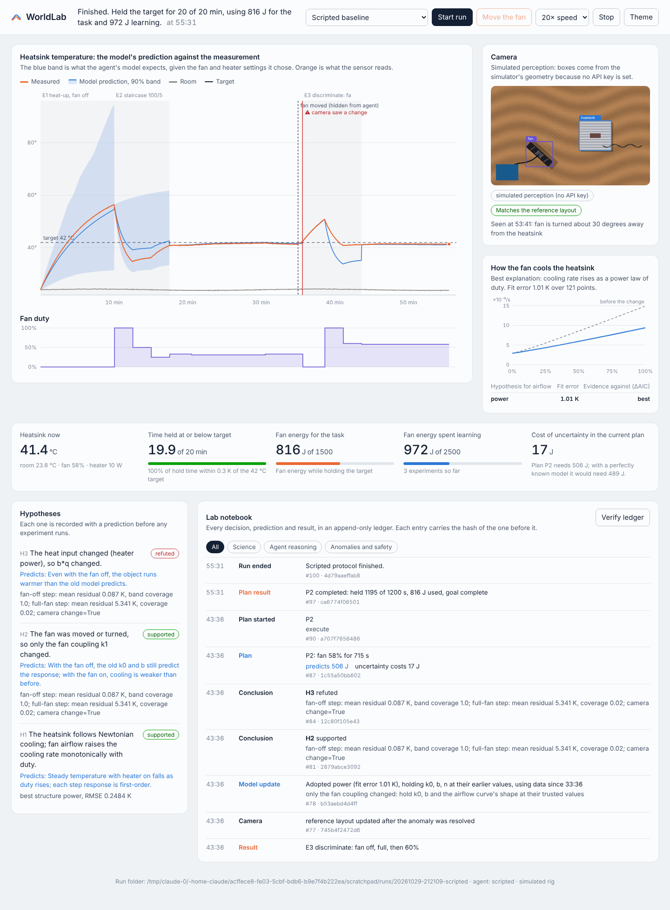

# WorldLab

**An AI agent that learns how a physical system behaves by designing and running experiments, and notices when the world changes under it.**

WorldLab runs a tabletop cooling rig: a heatsink warmed by a 10 W resistor (a stand-in for a chip), a PWM fan, temperature sensors and a top-down camera. The goal is ordinary engineering: *keep the heatsink at or below 42 °C for 20 minutes using as little fan energy as possible.* The agent starts knowing nothing about this particular rig. To meet the goal it has to:

1. form testable hypotheses about how the rig behaves,
2. choose experiments that are worth their energy cost,
3. fit and compare competing physical models against the evidence,
4. plan with honest uncertainty,
5. detect when its predictions stop matching reality (someone moves the fan),
6. work out *what* changed with a discriminating experiment, and recover.

Every hypothesis, prediction, experiment, result and decision is written to a hash-chained ledger and shown live on a dashboard.



*Blue is what the agent's model predicts; orange is what the sensor measures. At 35 min someone moves the fan (dotted line, hidden from the agent). The camera and the diverging measurement both flag it; the agent runs a fan-off / full-fan experiment, concludes that only the fan coupling changed, refits just that, and finishes the task at 100% compliance.*

Built for the Meta Global AI Developer Hackathon, theme **Push the Frontier**.

---

## How Meta's models are used

| Model | Role in WorldLab |
|---|---|
| **Muse Spark** (`muse-spark-1.3`, Meta Model API) | The scientist. It drives the whole loop through **tool calling**: it records hypotheses, picks experiments from predicted information gain and energy cost, decides when the model is good enough, investigates anomalies and concludes. Each tool call carries a written rationale that lands in the audit ledger. |
| **SAM 3.1** (`sam-3.1`, Meta Model API) | The eyes. Finds the *fan* and *heat sink* in the camera frame by noun phrase, so the lab can tell whether the setup physically changed. |
| **Muse Spark** image understanding + **structured output** | Judges whether the fan is aimed at the heatsink fins (a box can't show orientation), and falls back to perception grounding if SAM misses an object. |
| **Muse Glimmer** (open weights, Apache 2.0) | A drop-in scientist that runs on your own GPU or any OpenAI-compatible host. Same tools, same prompt, so the two models can be compared head to head on the benchmark. |

The language model never touches hardware directly. It decides; numerical code does the physics and a safety governor bounds every action.

## The science inside

The agent's tools are backed by real methods, so its decisions rest on numbers rather than vibes.

- **Grey-box physics.** `dT/dt = -k(u)(T - T_room) + b·q`, with four competing hypotheses for how airflow scales with fan duty `u`: linear, square-root (laminar), power law, and power law with a stall threshold. Fits are maximum a posteriori under a prior, integrated exactly between samples, with uncertainty corrected for autocorrelated residuals.
- **Evidence-weighted belief.** Predictions average over all four hypotheses with Akaike weights. Where the hypotheses disagree (typically at fan duties never tested), prediction bands widen honestly instead of extrapolating with false confidence.
- **Experiment design.** Every candidate experiment is scored by predicted outcome, energy cost, safety, expected information (linearised Fisher information, in bits) and, most usefully, *how much it shrinks the uncertainty that drives the energy decision*.
- **Robust planning.** The planner picks the cheapest fan schedule whose 95th-percentile temperature stays under target, and reports the **cost of uncertainty**: the extra joules spent because the model is not certain. Learning visibly drives that number down.
- **Trust region.** If a plan relies on a fan duty the model has never seen, it says so and proposes a short validation experiment first. Fans stall at low duty, and the benchmark showed this check matters.
- **Change detection.** While a plan runs, an ensemble of the model is driven by the *measured* inputs, and a two-sided CUSUM flags sustained divergence that is large enough to matter (≥ 0.6 K). Measured changes, such as the room warming, are absorbed by feedback without false alarms.
- **Diagnosis by experiment.** A fan-off step isolates natural convection and heat input from fan coupling. If the old model still explains the fan-off step but not the fan-on step, the fan moved. If both are off, the heat input changed. The refit then changes *only* what the supported hypothesis says changed.
- **Auditable.** The ledger is append-only and SHA-256 hash-chained; `python -m worldlab verify` detects any edit or deletion. Each experiment result stores a digest of its raw data.

## Bounded hardware control

- Fan duty is clamped to 0–100%. Experiments have a duration limit and a separate exploration energy budget.
- An experiment is refused if its median predicted temperature approaches the trip limit. Heater steps are *guarded*: they end early at 68 °C.
- If the object reaches 75 °C, the heater turns off and the fan goes to full, and the run is marked as tripped.
- When an anomaly fires, the fan goes to full ("fail toward cooling") while the agent investigates.
- The firmware enforces its own limits independently of the host: an 80 °C latched trip, a 10 s watchdog, and refusing the heater on a sensor fault.

---

## Quick start

Needs Python 3.10+ with `numpy` and `scipy` (Anaconda has both). No other packages are required.

```bash
git clone https://github.com/MoAmrYehia/WorldLab.git
cd WorldLab
python -m worldlab serve --open
```

Open http://127.0.0.1:8765, choose an agent and press **Start run**. While the agent holds the target, press **Move the fan** and watch it notice, investigate and recover. The simulator runs at 20× real time by default.

Without an API key, the agent falls back to the **scripted baseline** and perception to **simulated perception**, both clearly labelled. Everything else is identical.

### Muse Spark (Meta Model API)

```bash
# macOS / Linux
export MODEL_API_KEY=...        # from https://dev.meta.ai
# Windows PowerShell
$env:MODEL_API_KEY="..."

python -m worldlab serve --agent spark --open
```

Optional settings: `WORLDLAB_SPARK_MODEL` (default `muse-spark-1.3`) and `WORLDLAB_REASONING` (default `medium`).

### Muse Glimmer (open weights)

Serve Glimmer behind any OpenAI-compatible endpoint, then point WorldLab at it:

```bash
# llama.cpp (single consumer GPU, ~17 GB Q4 GGUF)
llama serve -hf meta-models/Muse-Glimmer-30B-GGUF \
  --hf-file Muse-Glimmer-30B-KQuant-17GB-Q4_K_M.gguf \
  -a muse-glimmer -ngl 99 -c 131072 -np 1 --host 127.0.0.1 --port 8080 --api-key local

export WORLDLAB_GLIMMER_BASE_URL=http://127.0.0.1:8080/v1
export WORLDLAB_GLIMMER_API_KEY=local
python -m worldlab serve --agent glimmer --open
```

Other options:

- **Ollama:** run `ollama run muse-glimmer`, then set the base URL to `http://localhost:11434/v1`.
- **vLLM:** use `--served-model-name muse-glimmer --enable-auto-tool-choice --tool-call-parser muse_glimmer`.
- **A hosted endpoint** such as Fireworks, Baseten or Modal: the hackathon partners offer credits. Set `WORLDLAB_GLIMMER_BASE_URL`, `WORLDLAB_GLIMMER_API_KEY` and `WORLDLAB_GLIMMER_MODEL` to that provider's values.

SAM 3.1 camera perception always uses the Meta Model API when `MODEL_API_KEY` is set.

### Headless runs and the benchmark

```bash
python -m worldlab run --agent spark --perturb fan_moved@2400       # one run, printed as it goes
python -m worldlab bench --worlds 10                                 # scripted agents, randomised worlds
python -m worldlab bench --worlds 5 --agents spark,glimmer,scripted  # compare the LLM scientists
python -m worldlab verify runs/<run>/ledger.jsonl                    # check the audit chain
python -m unittest discover -s tests -v                              # tests, no network needed
```

Each run writes `runs/<time>-<agent>/` containing `ledger.jsonl` (hash-chained), `samples.csv` (every sensor reading) and `frames/` (the camera images the agent looked at).

---

## Benchmark

The simulator hides its physics from the agent. The agent only sees sensor readings and camera frames, exactly as on hardware. That makes it possible to score the agent against ground truth across many worlds, each with a random heat capacity, airflow curve, fan stall point, fan efficiency and room temperature.

In each scenario, a change is made 600 s into the agent's first control plan:

- **none:** nothing changes.
- **fan_moved:** the fan is moved and turned. The camera can see this.
- **heater_drift:** the heater delivers 30% more than commanded. Nothing can see this except the physics.
- **ambient_step:** the room warms by 3 K. The room sensor measures this, so it should not cause an alarm.

Results across 10 randomised worlds (`python -m worldlab bench --worlds 10`; raw runs in `docs/bench/runs.json`):

| agent | scenario | goal_complete | compliance | detected | detect_s_median | false_alarms | diagnosis_ok | energy_overhead | exploration_J | model_error |
|---|---|---|---|---|---|---|---|---|---|---|
| scripted | none | 1.0 | 1.0 | - | – | 1 | 0.9 | 0.02 | 455.39 | 0.081 |
| scripted | fan_moved | 0.9 | 0.993 | 10/10 | 5.0 | 1 | 0.9 | – | 1232.26 | 0.078 |
| scripted | heater_drift | 0.9 | 0.93 | 9/10 | 60.0 | 1 | 0.5 | – | 1280.41 | 0.219 |
| scripted | ambient_step | 1.0 | 0.975 | - | 422.5 | 6 | 0.9 | – | 681.46 | 0.082 |
| scripted-noadapt | none | 0.8 | 0.8 | - | – | 12 | 1.0 | 0.016 | 353.09 | 0.099 |
| scripted-noadapt | fan_moved | 0.0 | 0.8 | 10/10 | 5.0 | 8 | 0.0 | – | 353.09 | 0.438 |
| scripted-noadapt | heater_drift | 0.0 | 0.754 | 10/10 | 62.5 | 8 | 0.0 | – | 353.09 | 0.099 |
| scripted-noadapt | ambient_step | 0.9 | 0.889 | - | 252.5 | 11 | 1.0 | – | 353.09 | 0.099 |

In plain terms:

- **When nothing changes**, every goal is met at 100% compliance, using 2% more fan energy than an oracle that knows the true physics, with one false alarm across 10 worlds.
- **When the fan is moved**, the change is caught in 10/10 worlds and correctly attributed to the fan in 9/10. The learned model ends within 8% of the truth, against 44% for the agent that never revises; that agent completes 0 of 10 goals.
- **A hidden heater drift** (invisible to the camera) is caught in 9/10 worlds, but attributed correctly in only half. Often the offset-free feedback absorbs it before a clean discriminating experiment is possible. This is the main open problem.
- **A measured room-temperature change** is handled by feedback without investigation in most worlds. Most of its alarms come from one near-degenerate world.

These are the scripted agent's numbers. The same benchmark runs Muse Spark and Muse Glimmer (`--agents spark,glimmer,scripted`) when an API key or endpoint is configured.


Columns:

- *goal_complete* and *compliance*: whether the 20-minute hold was finished, and the share of it spent at or below target.
- *detected* and *detect_s_median*: hidden changes caught, and the median time to catch them.
- *false_alarms*: alarms with no unexplained physical change behind them.
- *diagnosis_ok*: the supported hypothesis names what actually changed.
- *energy_overhead*: task fan energy per second versus an oracle that knows the true physics.
- *exploration_J*: energy spent on experiments.
- *model_error*: mean relative error of the learned cooling curve against the truth at the end.

`scripted-noadapt` is the same agent with anomaly handling switched off: it learns once and never revises. The gap between the two rows is what adapting is worth.

**Honest limits.**

- The hardware path (serial driver and firmware) is written and unit-tested against a fake port, but the benchmark is simulation only.
- Without an API key, camera perception is simulated from the scene geometry, and the dashboard labels it as such.
- A near-degenerate world (the target barely below the fan-off temperature, plus a fan that stalls at low duty) still produces occasional false alarms.

---

## Hardware rig (optional)

| Part | Notes |
|---|---|
| Arduino Uno or Nano | runs `firmware/worldlab_rig/worldlab_rig.ino` |
| 2 × DS18B20 | one bonded to the heatsink, one in free air; 4.7 kΩ pull-up on pin 2 |
| 120 mm 4-pin PWM fan, 12 V supply | PWM wire on pin 9 (25 kHz), common ground |
| Finned aluminium heatsink + 10 W power resistor | thermal paste between them |
| Logic-level N-MOSFET (e.g. IRLZ44N) | heater switch, gate on pin 7 via 100 Ω, 100 kΩ pull-down |
| USB webcam (optional) | top-down view for SAM 3.1 |
| INA219 (optional) | measures fan power; otherwise a fan power curve is used |

```bash
pip install pyserial opencv-python
python -m worldlab serve --rig serial --port COM3 --camera 0 --agent spark
```

---

## Layout

```
worldlab/
  model.py        thermal model, MAP fitting, Akaike mixture, prediction, information gain
  lab.py          the agent's tools: experiments, fitting, planning, monitoring, safety, energy accounting
  agent.py        Muse Spark / Muse Glimmer tool-calling scientist, and the scripted baseline
  llm.py          stdlib client for Meta Model API and OpenAI-compatible endpoints
  perception.py   SAM 3.1 + Muse Spark scene analysis, and simulated perception
  ledger.py       hash-chained audit ledger and verifier
  bench.py        ground-truth benchmark across randomised worlds
  server.py       dashboard server (standard library, server-sent events)
  dashboard/      single-file live dashboard
  rig/            simulator (hidden physics + camera renderer) and serial hardware driver
firmware/         Arduino firmware with independent safety limits
tests/            unit tests, including the agent loop against a mock OpenAI-compatible endpoint
```

## License

MIT. See [LICENSE](LICENSE).
